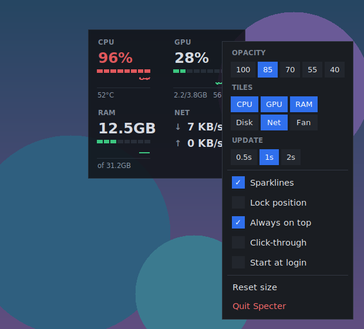

# Specter

A small hardware monitor for **Linux** and **Windows**: a compact, frameless, always-on-top panel
with adjustable opacity, so it can sit on your desktop without getting in the way.
Inspired by Speccy and GPU Temp.


## What it shows

| Tile | Values |
|---|---|
| CPU | load, temperature |
| GPU | load, memory, temperature, fan (NVIDIA, AMD, Intel; one tile per GPU) |
| RAM | used / total |
| DISK | read and write speed |
| NET | download and upload speed |
| FAN | fastest spinning fan |

Which of these you get depends on your hardware and OS. On Windows, temperatures and fans come
from [LibreHardwareMonitor](docs/sensors.md#set-up-librehardwaremonitor) if it runs, with a rough
CPU temperature fallback otherwise. Details per OS and GPU vendor: **[docs/sensors.md](docs/sensors.md)**.

Values turn yellow and red when they get high (load from 60 %, temperatures from 70 °C).
A tile with a bar can also draw a short history graph (sparkline).

## Using it

- **Move:** drag the panel with the left mouse button. It stops at the edge of the desktop but
  can cross from one monitor to the next.
- **Resize:** drag an edge or a corner. The tiles rearrange into a row, a column or a grid. When
  not all fit, you get fewer tiles with ‹ › arrows (or the mouse wheel) to cycle through them.
  Make it only about as tall as a taskbar and it becomes a one-line strip:

  

- **Right-click** for the menu:

  

  Opacity, which tiles to show, how often to read the sensors, sparklines, lock the position,
  click-through (X11), always on top, start at login (Linux), reset the size, quit.
  Settings are saved when you change them, in `config.json` in your user config folder
  (`~/.config/specter/` on Linux).

**Click-through** lets mouse clicks go to the window under the panel (handy over a video or a
game). A small blue dot appears in the panel's top-left corner: click it to get the menu back and
switch click-through off. It is not saved, so a restart is always clickable.

## Install and run

Requires Python 3.8+ with Tkinter. On Linux, prefer the system Python (`python3-tk`): its Tk draws
smooth fonts and uses your cursor theme, while the Tk bundled with uv-managed Pythons does not.

Linux:

```bash
python3 -m venv .venv           # or: uv venv --python /usr/bin/python3
.venv/bin/pip install -e ".[nvidia]"
.venv/bin/specter               # or: .venv/bin/python -m specter
```

Windows:

```bat
py -m venv .venv
.venv\Scripts\pip install -e ".[nvidia]"
.venv\Scripts\specter
```

(or `.venv\Scripts\python -m specter`)

The `nvidia` extra installs `nvidia-ml-py` for NVIDIA GPU sensors (leave it out if you have no
NVIDIA card). AMD and Intel GPUs need nothing extra. On Windows, also see
[Set up LibreHardwareMonitor](docs/sensors.md#set-up-librehardwaremonitor) for temperatures and
fans.

### A single-file program

```bash
pip install -e ".[nvidia,build]"
python tools/build.py           # -> dist/specter
```

The result runs without Python. Build it on the oldest Linux you want it to run on: it needs at
least the glibc of the machine that built it.

## Known limits

- **Opacity needs a compositor.** On Linux/X11 that is KWin, Mutter, Picom and so on. Without one
  the panel stays fully opaque.
- **Windows temperatures and fans** work best with LibreHardwareMonitor running. Without it you
  get at most an approximate CPU temperature (ACPI thermal zone, not on every PC) and no fans.
- **Intel GPU load on Linux is approximate** (shown with "~"): it is the GPU clock, because the
  real load counter needs root.
- **Windows support is still young.** It has been tried on one Intel laptop so far; see the
  [tested hardware](docs/sensors.md#tested-hardware) list.
- "Start at login" and click-through only work on Linux (X11) so far.

## Diagnostics

```bash
specter --sensors     # which sensor sources work here, and the values they give
specter --dump        # raw sensor data for bug reports
```

A sensor is missing or wrong? Paste both outputs into a GitHub issue, see
[Reporting a missing sensor](docs/sensors.md#reporting-a-missing-sensor).

## Development

```bash
pip install -e ".[dev,nvidia]"
pytest
```

Project notes for contributors are in `CLAUDE.md`, the roadmap is in `PLAN.md`.
The icon is drawn by `tools/make_icon.py`.

## Roadmap

More Windows testing (NVIDIA, AMD), alerts, themes, a detailed hardware specs view. See `PLAN.md`.
