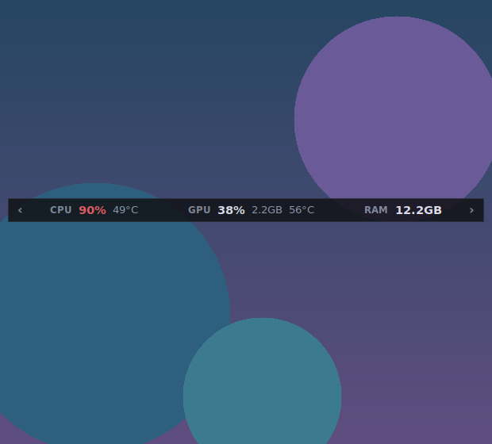

# Specter

A small hardware monitor for **Linux** and **Windows**: a compact, frameless, always-on-top panel
with adjustable opacity, so it can sit on your desktop without getting in the way.
Inspired by Speccy and GPU Temp.


> **Early test version.** Specter works on the machines it was tried on, but every PC exposes its
> sensors differently. If something is missing or looks wrong, please tell me:
> see [Trying Specter? Send feedback](#trying-specter-send-feedback).

## Download and run

Get the latest version from the **[Releases page](https://github.com/ZahariBakov/Specter/releases)**.
No Python or installation needed.

**Windows 10 / 11:** download `specter.exe` and double-click it.
Windows may show *"Windows protected your PC"*, because the program is new and not signed.
Click **More info → Run anyway**.

**Linux (X11 desktop):** download `specter`, then:

```bash
chmod +x specter
./specter
```

The panel appears in the top-right corner of the screen. **Right-click it for the settings menu.**
To close it: right-click → **Quit Specter**.

## What it shows

| Tile | Values |
|---|---|
| CPU | load, temperature |
| GPU | load, memory, temperature, fan (NVIDIA, AMD, Intel; one tile per GPU) |
| RAM | used / total |
| DISK | read and write speed |
| NET | download and upload speed |
| FAN | fastest spinning fan |

Which of these you get depends on your hardware and OS: a tile only appears when your PC reports
that value. DISK and FAN are hidden at first; switch them on in the menu (TILES).
Details per OS and GPU vendor: **[docs/sensors.md](docs/sensors.md)**.

Values turn yellow and red when they get high (load from 60 %, temperatures from 70 °C).
A tile with a bar can also draw a short history graph (sparkline).

## Using it

- **Move:** drag the panel with the left mouse button. It stops at the edge of the desktop but
  can cross from one monitor to the next.
- **Resize:** drag an edge or a corner. The tiles rearrange into a row, a column or a grid. When
  not all fit, you get fewer tiles with ‹ › arrows (or the mouse wheel) to cycle through them.
  Make it only about as tall as a taskbar and it becomes a one-line strip:

  

- **Right-click** for the menu:

  

  Opacity, which tiles to show, how often to read the sensors, sparklines, lock the position,
  click-through, always on top, start at login, reset the size, quit.
  Settings are saved as soon as you change them.

**Click-through** lets mouse clicks go to the window under the panel (handy over a video or a
game). A small blue dot appears in the panel's top-left corner: click it to get the menu back and
switch click-through off. It is not saved, so a restart is always clickable.

## Troubleshooting

| Problem | Why, and what to do |
|---|---|
| No **FAN** tile | Switch it on in the menu (TILES). If it is not listed there, your PC does not report fan speed. Many laptops don't, especially on Windows. |
| No CPU temperature or fans **on Windows** | Windows itself only offers a rough CPU temperature on some PCs. For real values, run [LibreHardwareMonitor](docs/sensors.md#set-up-librehardwaremonitor) as administrator with its web server on; Specter picks it up automatically. |
| No **GPU** tile | NVIDIA cards need the NVIDIA driver. On Linux, AMD and Intel GPUs are read from the kernel; on Windows from Windows' own counters. If it is still missing, please send the sensor report (below). |
| GPU load shows **"~"** | Intel GPU on Linux: the real load needs root, so Specter shows the GPU clock speed as an estimate. |
| **Opacity** does nothing (Linux) | Transparency needs a compositor (KWin, Mutter, Picom...). Without one the panel stays opaque. |
| Antivirus blocks `specter.exe` | A false alarm that is common for new, unsigned programs packed with PyInstaller. You can run Specter from source instead (below). |
| Two panels | Specter was started twice (e.g. once by Start at login). Quit one of them. |

## Trying Specter? Send feedback

Thank you for testing! The most useful things to send (as a
[GitHub issue](https://github.com/ZahariBakov/Specter/issues) or directly to me):

1. **Your PC:** Windows or Linux (which version), laptop or desktop, CPU and GPU model.
2. **A screenshot** of the panel.
3. **The sensor report**, which lists what Specter can read on your PC. Open a terminal in the folder
   with Specter and run:

   ```bat
   specter.exe --sensors > sensors.txt
   specter.exe --dump > dump.txt
   ```

   (Linux: `./specter --sensors > sensors.txt` and `./specter --dump > dump.txt`.)
   Then send `sensors.txt` and `dump.txt`. They contain only hardware information.
   (If `sensors.txt` stays empty on Windows, look for `specter-sensors.txt` and `specter-dump.txt`
   in the same folder: Specter writes them there when it has no console.)
4. **What was confusing or annoying**, what you missed, and what you liked.

## Uninstall

1. If you turned on **Start at login**, turn it off in the menu first.
2. Delete `specter.exe` / `specter`.
3. Optional: delete the settings folder, `%LOCALAPPDATA%\specter` (Windows) or
   `~/.config/specter` (Linux).

## Run from source

Requires Python 3.8+ with Tkinter. On Linux, prefer the system Python (`python3-tk`): its Tk draws
smooth fonts and uses your cursor theme, while the Tk bundled with uv-managed Pythons does not.

Linux:

```bash
python3 -m venv .venv           # or: uv venv --python /usr/bin/python3
.venv/bin/pip install -e ".[nvidia]"
.venv/bin/specter               # or: .venv/bin/python -m specter
```

Windows (in the Specter folder, in a normal, not administrator, terminal):

```bat
py -m venv .venv
.venv\Scripts\pip install -e ".[nvidia]"
.venv\Scripts\specter
```

The `nvidia` extra installs `nvidia-ml-py` for NVIDIA GPU sensors (leave it out if you have no
NVIDIA card). AMD and Intel GPUs need nothing extra. The sensor report works the same way:
`specter --sensors` and `specter --dump`.

### Building the single-file program

```bash
pip install -e ".[nvidia,build]"
python tools/build.py           # -> dist/specter (dist\specter.exe on Windows)
```

The result runs without Python. Build it on the oldest Linux you want it to run on: it needs at
least the glibc of the machine that built it. Windows builds must be made on Windows.

## Known limits

- Windows temperatures and fans are best with LibreHardwareMonitor running (see Troubleshooting).
- Click-through works on X11 and Windows, not on Wayland.
- Tested so far on a few machines only; see the [tested hardware](docs/sensors.md#tested-hardware)
  list.

## Development

```bash
pip install -e ".[dev,nvidia]"
pytest
```

Project notes for contributors are in `CLAUDE.md`, the roadmap is in `PLAN.md`.
The icon is drawn by `tools/make_icon.py`.

## Roadmap

Feedback from the first testers decides what comes next. Ideas: easier install (installer, app
menu entry), alerts, themes, a detailed hardware specs view. See `PLAN.md`.
